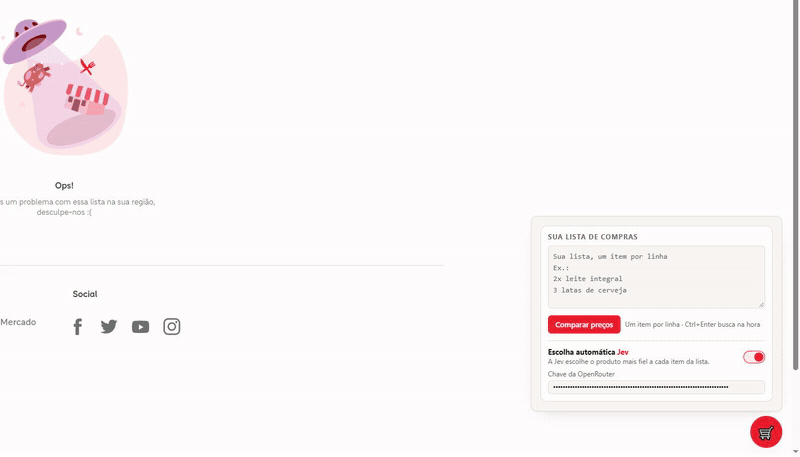

# Compara iFood

Extensão para Google Chrome que compara os preços da sua lista de compras em vários mercados do iFood de uma vez só e monta o carrinho no mais barato.



<video src="video/compara-ifood-showcase.mp4" controls width="720" aria-label="Demonstração da extensão Compara iFood"></video>

[Baixar o vídeo da demonstração (MP4)](video/compara-ifood-showcase.mp4)

## O que ela faz

Você cola sua lista de compras no painel — um item por linha, no seu jeito (`2x leite integral`, `3 latas de cerveja`, `1kg de arroz`) — e a extensão:

- **Busca cada item nos mercados da sua região** e monta uma tabela com total, cobertura e distância de cada loja;
- **Ordena quem tem a lista inteira primeiro**, porque mercado que falta item não é mais barato, é furada;
- **Deixa você trocar o produto** que o iFood escolheu (aquele "leite condensado" que veio como pudim, por exemplo) por qualquer alternativa do mesmo mercado, e ajustar a quantidade de cada item direto na tabela;
- **Filtra só os mercados completos** com um clique;
- **Monta o carrinho no seu navegador**, item por item, com a sua sessão — você só revisa e finaliza o pagamento no iFood, como sempre fez.

Tudo acontece na sua aba do iFood. Não tem servidor, não tem conta, não tem cadastro.

## Instalação

1. Baixe ou clone este repositório;
2. Abra `chrome://extensions` no Chrome;
3. Ative o **Modo do desenvolvedor** (canto superior direito);
4. Clique em **Carregar expandido** e escolha a pasta `extension/` deste repositório;
5. Pronto — o botão 🛒 aparece no canto das páginas do iFood.

A extensão usa a sua própria sessão do iFood: se você já está logado no navegador, ela funciona imediatamente. Não é preciso informar senha nem celular em lugar nenhum.

## Como usar

1. Abra o iFood normalmente e clique no botão 🛒;
2. Cole a lista de compras e clique em **Comparar preços**;
3. Veja o ranking dos mercados com o total de cada um — o ⭐ marca o mais barato entre quem tem tudo;
4. Abra **Ver itens** para trocar produtos (`↻ Trocar`), mudar quantidades ou conferir preços unitários;
5. Clique em **Montar carrinho** — a extensão navega até a loja e adiciona os itens enquanto você acompanha;
6. Abra o carrinho pelo ícone do próprio iFood e finalize a compra.

## Jev: escolha automática de produtos (opcional)

O campo de busca do iFood é solto — para "leite condensado" ele pode devolver um pudim. Se você quiser uma segunda opinião, ligue o toggle **Jev** no painel: o modelo de decisão [Jev](https://www.typesafe.ai/) (via [OpenRouter](https://openrouter.ai/)) escolhe, para cada item da lista, o produto que mais se parecem com o que você pediu — e os mercados passam a mostrar esse produto quando ele existe.

Para ativar: cole a sua chave da OpenRouter no campo do painel (configuração → "Escolha automática"). A chave fica salva apenas no `localStorage` do seu navegador e as descrições dos produtos são enviadas para a OpenRouter **só quando o Jev está ligado**. Sem chave, a extensão funciona igualzinho, escolhendo o mais barato de cada mercado.

## Privacidade

- A extensão roda 100% no seu navegador. Não tem backend, analytics nem telemetria;
- Cookies, endereço e sessão do iFood **não saem do seu computador**;
- A única requisição externa possível é a do Jev, opcional, com a sua própria chave;
- Os arquivos de sessão (`profile/`), depuração e chaves ficam fora do repositório por padrão (`.gitignore`).

## Estrutura do repositório

```
extension/    manifest.json, bridge.js, content.js — a extensão (sem build, sem dependências)
video/        demonstrações (GIF/MP4) e o projeto das animações
```

A extensão é JavaScript puro: `content.js` cuida da interface (Shadow DOM, então o layout do iFood não briga com o dela) e `bridge.js` lê os cabeçalhos das chamadas que a própria página faz para reutilizar a sua sessão.

## Vídeo de divulgação

<video src="video/compara-ifood-linkedin.mp4" controls width="720" aria-label="Vídeo de divulgação da extensão Compara iFood"></video>

[Baixar o vídeo de divulgação (MP4)](video/compara-ifood-linkedin.mp4)

## Aviso

Projeto pessoal, sem qualquer vínculo com o iFood ou a Prosus. "iFood" é marca dos seus detentores. Use por sua conta e risco — e lembre-se de revisar o carrinho antes de pagar.
